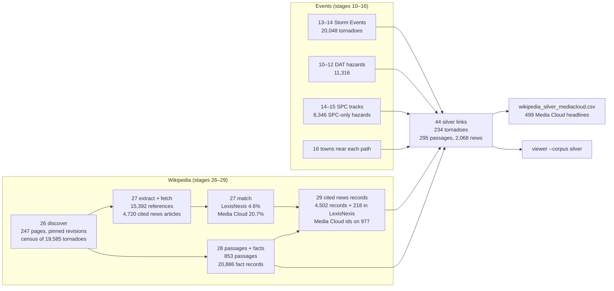
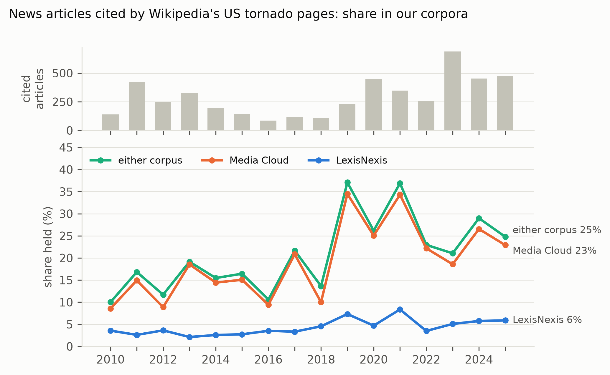
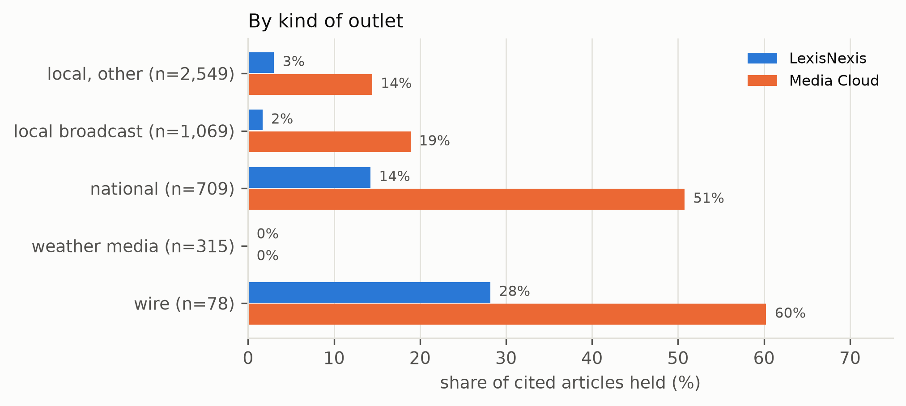
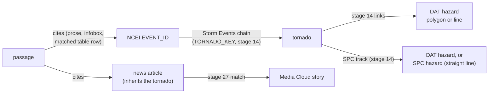
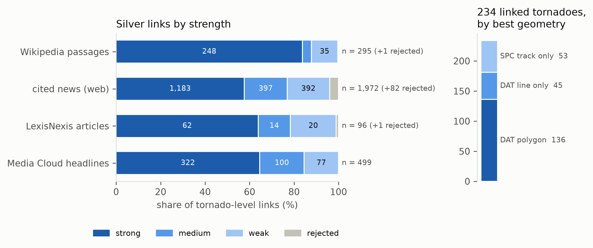

# Wikipedia in the tornado dataset: overview, files and tools

What the Wikipedia work does, where its outputs are, and how to inspect them.
All numbers are from the run of 2026-11-13 on branch `wikipedia-text-sources`
(window 2010–2025, US only). The stage reports in `outputs/` are the
authoritative figures; this page summarises them. A shorter version written as
a methods section is in [`methods_wikipedia.md`](methods_wikipedia.md).

## In one paragraph

English Wikipedia is used three ways. (1) **Text source:** its US tornado
articles, the per-tornado sections of outbreak articles, outbreak overviews and
the US event sections of the yearly *Tornadoes of <year>* pages become 853 text
passages, with tables and infoboxes kept apart as 20,886 fact records.
(2) **Coverage yardstick:** the 4,720 news articles those pages cite were
chosen by editors who never saw our corpora, so the share we hold is an
independent recall estimate: LexisNexis holds 4.6%, Media Cloud 20.7%, and one
or the other 22.6%. (3) **Silver labels:** passages cite NCEI Storm Events
records; following those ids to a tornado and its damage path gives 295
passages and 2,068 news articles linked to one of 234 tornadoes, each link
checked against the official record and graded by strength. As Media Cloud
stories, that is 499 distinct headlines. This is the evaluation set for the
news → tornado-path linker.

## Pipeline



| Stage | Script | What it does |
|---|---|---|
| 26 | `scripts/26_discover_wikipedia.py` | Finds the pages through seven channels (categories, year navboxes, yearly-page links, search, Wikidata, list-page links, `{{Main}}` links), classifies them, pins each to its revision and stores the wikitext; parses the list pages into a census. |
| 27 | `scripts/27_wikipedia_reference_coverage.py extract · fetch · match` | Extracts every reference with the section and context (prose, table, infobox) it is cited from; fetches the cited news text (publisher, else Wayback Machine); matches the cited articles against LexisNexis and Media Cloud. |
| 28 | `scripts/28_wikipedia_passages.py` | Cuts the pinned revisions into passages; tables and infoboxes become fact records linked to the passages. |
| 29 | `scripts/29_wikipedia_cited_news.py` | Turns cited news into text records (or a LexisNexis cross-reference), with text quality, syndication groups, citing passages and Media Cloud ids. |
| 44 | `scripts/44_wikipedia_silver_links.py` | Links passages and cited news to tornadoes through NCEI ids, checks every link against Storm Events, grades it, adds the geometry; writes the hand-check sheet. |
| – | `scripts/figures_wikipedia.py` | Draws the figures on this page into `docs/figures/`. |

The events stages (10–16) are the other branch's; for this work they were
rerun locally from the server's DAT cache, the NCEI Storm Events files, SPC's
`1950-2025_actual_tornadoes.csv` (saved by hand: spc.noaa.gov's robots.txt
disallows automated download) and the server's gazetteer cache.

## 1 · Which pages (stage 26)

1,030 candidate pages, **247 in scope**: 111 dedicated tornado articles, 120
outbreak articles and 16 yearly pages. Every in-scope page was found by at
least two of the six search channels except one, so a rerun is unlikely to
miss pages. Excluded: list pages (their rows paraphrase the NCEI narrative they
cite), non-US pages, and articles about other events that carry a tornado
infobox (the February 2021 winter storm, the 2012 Hawaii hailstorm). Each page
is pinned to the revision it had at discovery (21–26 Oct 2026), and the
wikitext is stored, so every later stage reads the same text.

The list pages and the tables inside 86 outbreak articles form a **census of
19,585 US tornadoes**, most with an NCEI event id. It is used only for lookup.

## 2 · Cited news and corpus coverage (stage 27)

15,392 references on the 247 pages; 5,278 are news, which are **4,720 distinct
cited articles** (one URL cited from several pages counts once). Text was
retrieved for 4,093 of the 4,709 that have a URL (publisher first, Wayback
Machine copy nearest the citation date otherwise; robots.txt honoured).

**LexisNexis** (22,896 articles, no URLs) is matched in tiers: same outlet
with ±3 days and agreeing headlines (`title_outlet`), another outlet with a
near-identical headline (`title_syndicated`, wire copy), and the cited text
contained in a LexisNexis body (`content`). A weak `title_fuzzy` tier is
reported separately. A blind hand check of 70 pairs found the strong tiers
95–100% precise (`outputs/annotation/wikipedia_ref_handcheck_labels.csv`).

**Media Cloud** (491,432 stories from the US national and state & local
collections, stage 22's query) keeps URLs, so the strongest tier is the
**normalised URL**. The title tiers then catch the same article under another
URL, and wire copy in another outlet. Media Cloud's export has no text, so it
has no content tier.

| held by | share of the 4,720 cited articles |
|---|---|
| LexisNexis (strong tiers) | 4.6% (4.1–5.3%) |
| Media Cloud (URL, title_outlet, title_syndicated) | 20.7% (19.6–21.9%) |
| of which the cited article itself (URL or title_outlet) | 17.3% |
| either corpus | 22.6% (21.4–23.8%) |





Media Cloud's coverage rises after 2018, with its collections. Weather media
(weather.com, foxweather.com, AccuWeather: 315 citations) are in neither
corpus. Of the 977 cited articles Media Cloud holds, stage 30's headline label
is `EVENT` for 69%. The rest are mostly context articles (outages, relief),
plus some tornado stories the headline filter misses.

## 3 · Passages and facts (stage 28)

| unit | links to | passages | median words |
|---|---|---:|---:|
| `tornado_article` | one tornado | 111 | 2,003 |
| `tornado_section` (of an outbreak article) | one tornado | 236 | 515 |
| `outbreak_overview` (the rest of the outbreak article) | an episode | 120 | 999 |
| `yearly_event` (US section of *Tornadoes of <year>*) | an episode | 386 | 183 |

853 passages, 637,141 words, CC BY-SA 4.0 (stored with revision permalink).
An outbreak article becomes one passage per tornado section plus an overview,
which mirrors how news covers a single tornado vs. the whole outbreak.

**Tables and infoboxes are not in the passage text.** They are **fact
records** (`wikipedia_facts.csv`: 20,419 table rows and 467 infoboxes, each
with date, UTC time, rating, location, counties, path length and width, NCEI
ids, and the page's Wikidata item). Facts are copied from the NWS survey and
NCEI, so they may label or check a link, never be the linker's input. Fact
links (`wikipedia_fact_links.csv`) say how a fact belongs to a passage:

- `infobox_of`: the passage's own infobox. Outbreak articles give each
  significant tornado's section its own infobox.
- `listed_in_outbreak`: a row of the outbreak article's tables.
- `same_tornado`: the table row about the tornado a section or article
  describes. It is matched by a shared NCEI id (155 passages), by most of the
  heading's places (91) or by the only tornado naming one of them (44), within
  the passage's date window (a section: its outbreak's start −1 to +14 days;
  a dated article: ±1 day) and state. A section with no date of its own takes
  its row's date.

**NCEI ids are attributed by context.** Every citation is marked prose, table
or infobox. A passage's `ncei_event_ids` are only those its prose cites; table
ids are kept apart (`ncei_event_ids_tables`), and the ids of matched facts are
in `ncei_event_ids_facts`. Before this split, an outbreak overview was credited
with every id in its tables.

## 4 · Cited news records (stage 29)

The 218 cited articles LexisNexis holds get no second copy. They go to
`wikipedia_cited_lexisnexis.csv` with the LexisNexis id. The other **4,502
become text records** (collection `wikipedia_citations`), with:

- **`text_quality`**: is the retrieved text the article? `good` for 3,607.
  The others are paywalls, video pages, site fronts, or a different article.
- **`story_id`**: syndicated copies grouped by the same headline on the same
  day, or by shared text; one `story_primary` per story.
- **Citations**: the passages citing each article
  (`wikipedia_cited_news_citations.csv`, 4,896 pairs).
- **`mc_ids` / `mc_tier` / `mc_label`**: the Media Cloud stories it is (847
  records and 130 LexisNexis cross-references).

## 5 · Silver links (stage 44)



**Passages.** A passage's evidence is the NCEI ids in its prose, in its own
infobox, and in its matched table row. Each id resolves to a whole tornado
through Storm Events' chained county segments. The tornado is then checked
against the passage:

- date within ±1 day, or within 14 days for a section dated only by its
  outbreak's start;
- state;
- a place: a heading town among the tornado's counties, its Storm Data begin
  or end town, or its narrative;
- rating.

If the ids name several tornadoes, the one most checks agree with wins.

**Strength:**

| strength | rule |
|---|---|
| *strong* | one tornado; date, state and a place all agree |
| *medium* | one tornado; nothing disagrees; a place or the rating agrees |
| *weak* | nothing disagrees but little could be checked, or the tornado was chosen among several |
| *rejected* | date or state disagrees (e.g. 2025 Marion, Illinois cites Enderlin's record) |

**News** inherits a tornado only when every tornado-level passage citing it
agrees. It takes the weakest citing strength, one step lower if published
before the event or more than 60 days after.

News is **rejected** when its retrieved text (or LexisNexis body) names none
of the tornado's places: heading towns, counties, Storm Data towns anywhere, or
gazetteer towns within 25 km of the path written as proper names. Wikipedia
then cites it for something else, e.g. the Enderlin article cites a
retrospective on the 1978 Elgin tornado for "deadliest since". A LexisNexis
article matched by several citations is one row and is linked only if they
agree.

**Geometry.** Each link carries the tornado's best path:

1. a DAT damage polygon (136 tornadoes);
2. else a DAT track line (45);
3. else SPC's straight start–end line, for tornadoes DAT never surveyed (53),
   such as Joplin 2011.

DAT hazards are reached through the Storm Events links and through the SPC
track.



| | strong | medium | weak | kept | rejected |
|---|---:|---:|---:|---:|---:|
| Wikipedia passages | 248 | 12 | 35 | 295 | 1 |
| cited news (web) | 1,183 | 397 | 392 | 1,972 | 82 |
| LexisNexis articles | 62 | 14 | 20 | 96 | 1 |
| Media Cloud headlines (distinct `dup_group`) | 322 | 100 | 77 | 499 | – |

Episode level: 131 outbreak overviews and yearly sections link to the set of
tornadoes they cite, and 1,216 news articles cited only by one of them inherit
that set.

**On Media Cloud**, the 499 headlines (2,137 rows, since one wire story runs
in many outlets) cover 101 tornadoes. 404 are labelled `EVENT`; these are the
stories the linker is run on. Count by `mc_dup_group`, not rows.

**Not yet measured.** The strengths rank links; their precision comes from the
blind hand check (97 rows, unlabelled). Known limits: a citation is not a
label (an article cited in a tornado's section can be about the outbreak);
Wikipedia text is easier than news, since it is written after the survey;
duplicates are flagged, not removed (61 tornadoes have both an article and a
summarising outbreak section, see `summarises`; syndicated copies, see
`story_primary`).

## Where to look

### Tools

| Tool | Start | What it is for |
|---|---|---|
| **Silver viewer** | `python scripts/viewer.py --corpus silver` → http://127.0.0.1:8799 | One tornado at a time: path on an OpenStreetMap map (DAT polygon and line, SPC track, Storm Events segments), the Storm Events narrative, and every linked passage and news article with URL, archive link, full text and highlighted places. Strengths are hidden until `b` is pressed (blind). Rejected links appear in their own section, with the reason. Media Cloud tags show on news cards. Search finds names, counties, states and sheet rows (`s012`); `j`/`k` move between tornadoes. |
| **Datasette browser** | `python scripts/browse_wikipedia.py` → http://127.0.0.1:8001 | All Wikipedia tables in one SQLite file with full-text search and facets: `passages`, `cited_news`, `cited_news_citations`, `cited_in_lexisnexis`, `pages`, `sections`, `refs`, `ref_matches`, `census`, `facts`, `fact_links`, `silver_links`. Good for ad-hoc filtering and SQL. |
| **Stage reports** | `outputs/wikipedia_*_report.md` | The figures behind every number here (see below). |
| **Hand-check sheets** | `outputs/annotation/` | `wikipedia_ref_handcheck.csv` (LexisNexis matches; labelled, labels in `wikipedia_ref_handcheck_labels.csv`) and `wikipedia_silver_handcheck.csv` (97 silver links, blind, **not yet labelled**; save as `wikipedia_silver_handcheck_labels.csv`). |

Both servers bind to 127.0.0.1 only: they serve copyrighted news text.

### Reports (in git)

| Report | Stage |
|---|---|
| `outputs/wikipedia_discovery_report.md` | 26: pages, channels, census, where EF3+ prose lives |
| `outputs/wikipedia_reference_coverage_report.md` | 27: LexisNexis coverage, hand check, misses |
| `outputs/wikipedia_reference_coverage_mediacloud_report.md` | 27: Media Cloud coverage, labels, both corpora side by side |
| `outputs/wikipedia_passages_report.md` | 28: passages, facts, table matching |
| `outputs/wikipedia_cited_news_report.md` | 29: text quality, stories, citations, Media Cloud ids |
| `outputs/wikipedia_silver_links_report.md` | 44: silver links, rejections, Media Cloud set, hand check |

### Data files (in `data/`, not in git)

| File | What |
|---|---|
| `raw/wikipedia/pages/<pageid>/<revid>.json` | pinned wikitext per page |
| `raw/wikipedia/ref_fulltext.jsonl` | fetched cited-news texts (copyrighted) |
| `interim/wikipedia_pages.csv`, `wikipedia_sections.csv`, `wikipedia_census.csv` | stage 26 |
| `interim/wikipedia_refs.csv`, `wikipedia_news_articles.csv` | stage 27 references and cited articles (with LexisNexis and `mc_*` columns) |
| `interim/wikipedia_ref_matches.csv`, `wikipedia_ref_matches_mediacloud.csv` | stage 27 match pairs |
| `processed/wikipedia_passages.jsonl`, `wikipedia_textrefs.csv` | stage 28 passages (with and without text) |
| `processed/wikipedia_facts.csv`, `wikipedia_fact_links.csv` | stage 28 facts |
| `processed/wikipedia_cited_news.jsonl`, `…_textrefs.csv`, `…_citations.csv`, `wikipedia_cited_lexisnexis.csv` | stage 29 |
| `processed/wikipedia_silver_links.csv` | stage 44: every link with strength, checks, `reject_reason`, geometry, Media Cloud ids |
| `processed/wikipedia_silver_mediacloud.csv` | stage 44: one row per Media Cloud story |
| `interim/wikipedia_silver_handcheck_key.csv` | key to the blind sheet |
| `processed/wikipedia_browse.db` | Datasette database |

Inputs from other stages: `processed/mediacloud_filtered.csv.gz` (stage 30,
from the server), `outputs/lexisnexis_articles.jsonl` (stage 23),
`interim/storm_events_tornadoes.csv` and `processed/*links*` (stage 14),
`processed/hazard_episodes_*`, `spc_hazards_*` (stage 15),
`processed/hazard_geography_*` (stage 16).

**Server.** `/data/share/geoai/tornado-text-to-trajectory/data` holds the
Wikipedia pages and tables as uploaded on 2026-11-13. The later outputs (facts,
silver links, the Media Cloud matches, the local stage 14–16 reruns) are on
this machine only until uploaded.

## Rerun

```bash
python scripts/26_discover_wikipedia.py                 # from cache; --refresh asks Wikipedia again
python scripts/27_wikipedia_reference_coverage.py extract
python scripts/27_wikipedia_reference_coverage.py fetch # hours, resumable; skips what is stored
python scripts/27_wikipedia_reference_coverage.py match # LexisNexis + Media Cloud
python scripts/28_wikipedia_passages.py
python scripts/29_wikipedia_cited_news.py
python scripts/44_wikipedia_silver_links.py             # needs stages 12, 14 (15, 16 optional)
python scripts/figures_wikipedia.py
python scripts/00_selftest.py                           # 140 checks, no data needed
```

## Open items

- Label the 97-row silver hand-check sheet to turn strengths into precision.
- Decide how to count duplicates in evaluation (passage pairs via
  `summarises`, syndicated copies via `story_primary` / `mc_dup_group`).
- Upload the newer outputs to the server; push the branch.
- Single-tornado aftermath paragraphs stay in the outbreak overview (not moved
  to the tornado's passage).
